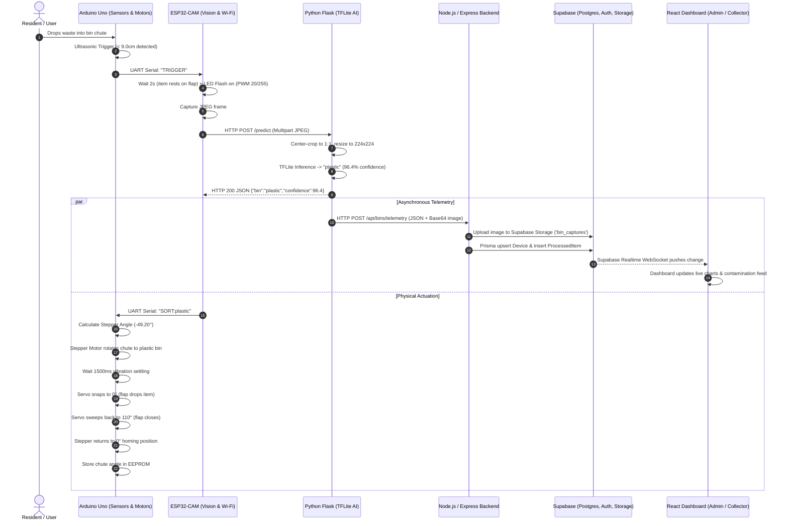

# SmartSort: Comprehensive Codebase & Architecture Guide

This document provides a comprehensive technical breakdown of the entire **SmartSort** repository. It explains what the project does, details every folder and file, defines the technical concepts and third-party services utilized, and illustrates the end-to-end data pipeline.

---

## Table of Contents
1. [Executive Summary: What Does the Codebase Do?](#1-executive-summary-what-does-the-codebase-do)
2. [End-to-End System Lifecycle](#2-end-to-end-system-lifecycle)
3. [Core Services & Technical Terminology Defined](#3-core-services--technical-terminology-defined)
   - [What is Prisma & What Does It Do Here?](#what-is-prisma--what-does-it-do-here)
   - [What is Supabase & What Does It Do Here?](#what-is-supabase--what-does-it-do-here)
   - [Key Technical Concepts & Glossary](#key-technical-concepts--glossary)
4. [Project Directory Tree Overview](#4-project-directory-tree-overview)
5. [Exhaustive Breakdown of All Folders & Files](#5-exhaustive-breakdown-of-all-folders--files)
   - [Root Project Files](#root-project-files)
   - [Hardware Firmware (`hardware/`)](#hardware-firmware-hardware)
   - [Machine Learning & Vision Service (`smartsort-ml/`)](#machine-learning--vision-service-smartsort-ml)
   - [Node.js & Express Backend Service (`smartsort-backend/`)](#nodejs--express-backend-service-smartsort-backend)
   - [React / TypeScript Frontend Client (`src/`)](#react--typescript-frontend-client-src)
   - [Public Assets & PWA Engine (`public/`)](#public-assets--pwa-engine-public)
   - [Project Specifications & Guidelines (`guidelines/`)](#project-specifications--guidelines-guidelines)
6. [Data Flow & Integration Summary](#6-data-flow--integration-summary)

---

## 1. Executive Summary: What Does the Codebase Do?

**SmartSort** is an Internet-of-Things (IoT) and Artificial Intelligence (AI) powered autonomous waste classification, sorting, and municipal logistics system.

Instead of relying on human sorting, SmartSort uses a custom physical smart bin equipped with dual microcontrollers (**Arduino Uno** and **ESP32-CAM**). When a user drops waste into the hopper:
1. An ultrasonic sensor detects the item.
2. The ESP32-CAM illuminates the chamber and takes a photo.
3. A local Python Machine Learning server uses a **TensorFlow Lite** computer vision model to identify whether the item is **Glass**, **Metal**, **Paper**, **Plastic**, or **Rejected Waste**.
4. The system mechanically indexes an internal routing chute via a **stepper motor** to align with the correct compartment, and drops a **servo-actuated flap** to deposit the item.
5. Ultrasonic fill-level sensors measure compartment capacities every 30 seconds.
6. The data, confidence score, and high-resolution photo are transmitted to a **Node.js Express backend**, which writes records to a **Supabase PostgreSQL database** using **Prisma ORM**, stores the photos in **Supabase Storage**, and broadcasts updates over **Supabase Realtime WebSockets**.
7. An administrative and collector **React + TypeScript Progressive Web App (PWA)** visualizes live telemetry, triggers automated alerts, auto-schedules collection jobs when bins reach 80% capacity, and optimizes garbage truck pickup routes using the **Traveling Salesperson Problem (2-Opt TSP)** algorithm.

---

## 2. End-to-End System Lifecycle



---

## 3. Core Services & Technical Terminology Defined

### What is Prisma & What Does It Do Here?
* **What it is:** **Prisma** is a next-generation Object-Relational Mapper (ORM) for Node.js and TypeScript. Traditional raw SQL queries are prone to syntax errors, SQL injection, and lack auto-completion. Prisma provides a declarative schema language where you model your entities, and it generates a strongly typed database client.
* **What Prisma does in SmartSort:**
  1. **Schema Definition (`smartsort-backend/prisma/schema.prisma`):** Declares models (`Device`, `User`, `Facility`, `CollectionJob`, `BulkCollectionJob`, `ProcessedItem`, `Alert`, `DeviceEvent`, `Feedback`, `AuditLog`) with their relations, indexes, and constraints.
  2. **Database Migrations:** Prisma tracks database evolution (`prisma/migrations/`) and applies SQL schema updates to the PostgreSQL database.
  3. **Type-Safe Queries:** Backend controllers and services call `prisma.device.findMany()`, `prisma.processedItem.create()`, or `prisma.collectionJob.update()`, guaranteeing safe types and eliminating raw SQL boilerplate.
  4. **Connection Pooling Adapter (`@prisma/adapter-pg`):** Uses the `pg` driver with connection pooling to ensure the backend does not exceed database connection limits on managed cloud databases.

---

### What is Supabase & What Does It Do Here?
* **What it is:** **Supabase** is a cloud backend-as-a-service platform built on top of enterprise-grade **PostgreSQL**. It bundles authentication, object storage, real-time WebSocket subscriptions, and database hosting into a single unified platform.
* **What Supabase does in SmartSort:**
  1. **Managed PostgreSQL Database:** Hosts the entire relational database that Prisma connects to via `DATABASE_URL`.
  2. **Supabase Auth (`@supabase/supabase-js`):** Manages user signups, logins, and session lifecycles. When a manager or collector logs in, Supabase issues a cryptographically signed **JSON Web Token (JWT)**.
  3. **Backend Auth Verification (`smartsort-backend/middleware/auth.js`):** The Express backend intercepts requests, verifies the JWT with Supabase's `auth.getUser(token)`, links the session to a local `User` record, and enforces Role-Based Access Control (`ADMIN`, `MANAGER`, `COLLECTOR`).
  4. **Supabase Storage (`bin_captures` bucket):** When the ESP32-CAM captures an image, the backend uploads the JPEG buffer to Supabase Storage and saves the generated public URL in the `ProcessedItem.imageUrl` column.
  5. **Supabase Realtime (`postgres_changes`):** Used in the React frontend hook `useRealtimeData.ts`. Instead of hammering the server with periodic HTTP polling, the frontend subscribes to WebSocket events on tables like `Device`, `Alert`, and `ProcessedItem`. When a row changes, Supabase notifies the browser immediately.

---

### Key Technical Concepts & Glossary

| Term | Technical Meaning & Role in SmartSort |
| :--- | :--- |
| **Dual-Microcontroller Architecture** | Splitting hardware duties between an **Arduino Uno** (high GPIO count, motor driver pulses, real-time sensor polling) and an **ESP32-CAM** (Wi-Fi stack, OV2640 camera streaming). This prevents motor electrical noise from crashing the Wi-Fi stack and avoids pin exhaustion. |
| **UART (Universal Asynchronous Receiver-Transmitter)** | A hardware serial communication protocol. The Arduino and ESP32 communicate over digital pins using `SoftwareSerial` (`RX: Pin 10, TX: Pin 11`) exchanging commands like `"TRIGGER"` and `"SORT:plastic"`. |
| **EEPROM (Electrically Erasable Programmable Read-Only Memory)** | Non-volatile memory on the Arduino microchip that survives power loss. SmartSort records the stepper chute's exact mathematical angle to EEPROM so the chute can safely self-home if power drops during a sorting cycle. |
| **PWM (Pulse Width Modulation)** | Rapidly toggling a digital pin between HIGH and LOW to simulate an analog voltage. Used to control the SG90 servo motor angle (0° to 110°) and dial down the ESP32 flash LED brightness (duty cycle `20/255`) to prevent voltage brownouts. |
| **Center-Crop Preprocessing** | An image manipulation technique where the center square of a 4:3 camera photo is extracted before resizing to `224x224`. This preserves the true physical proportions of waste objects without squishing or distorting features before neural net inference. |
| **TensorFlow Lite (TFLite) & LiteRT** | Google's high-efficiency, lightweight machine learning runtime optimized for edge devices and servers without large GPUs. SmartSort executes `smart_bin_model.tflite` directly on the CPU in milliseconds. |
| **Haversine Formula** | A spherical trigonometry equation that calculates the great-circle distance between two latitude/longitude points on Earth. Used by the backend to measure road distances between smart bins and municipal depots. |
| **Traveling Salesperson Problem (TSP) & 2-Opt** | An NP-hard computer science problem: finding the shortest route that visits a set of locations and returns to the depot. SmartSort implements the **2-Opt heuristic** algorithm in `routeOptimizationService.js` to eliminate crossing paths and reduce fuel/CO2 consumption by ~35%. |
| **In-Flight Deduplication & Token Caching** | Performance optimizations in `middleware/auth.js`. Verifying JWTs against cloud auth services on every HTTP request adds network latency. The backend caches validated tokens for 5 minutes and uses a mutex-like promise map to prevent multiple identical requests from triggering redundant network calls. |
| **PWA (Progressive Web App) & Service Worker** | A modern web architecture enabling a web application to be installed like a native mobile app on Android/iOS, featuring offline caching via a background `Service Worker` script (`public/sw.js`). |
| **Sentry APM** | Application Performance Monitoring and Error Tracking SDK (`@sentry/node`, `@sentry/react`). Automatically catches uncaught exceptions, tracks API route latencies, and reports them to a centralized observability dashboard. |
| **Winston & Daily Rotate File** | An enterprise Node.js logging framework that outputs colorized logs to stdout in development and writes timestamped log files to disk with automatic daily rotation. |
| **Zod** | A TypeScript-first schema declaration and data validation library used to sanitize incoming HTTP payloads before executing controller logic. |

---

## 4. Project Directory Tree Overview

```text
SmartSort/
├── .agents/                        # IDE agent configs, skills & design rules
├── guidelines/                     # Project PRDs, thesis docs, wiring instructions
├── hardware/                       # Microcontroller C++ / Arduino firmware (.ino)
│   ├── arduino_smartsort/          # Main Arduino Uno sensor & motor driver code
│   ├── esp32_cam_main/             # ESP32-CAM vision, Wi-Fi & HTTP bridge
│   ├── HardwareDiag/               # Integrated hardware diagnostic tests
│   ├── hardware_diagnostic/        # Sensor diagnostic suite
│   ├── MotorDiag/                  # Stepper & Servo actuation tester
│   ├── servo_calibration/          # Flap angle calibration firmware
│   └── test_smartsort/             # End-to-end hardware loopback test
├── public/                         # Static assets, web app icons, PWA manifest & worker
├── smartsort-backend/              # Express.js REST API & Business Logic
│   ├── controllers/                # Request handlers & response dispatchers
│   ├── cron/                       # Scheduled background jobs (auto-schedule, offline check)
│   ├── lib/                        # Shared clients (Prisma client & pg connection pool)
│   ├── middleware/                 # Auth, logging, rate limiting, error handlers
│   ├── prisma/                     # Database schema definition, migrations & seed scripts
│   ├── routes/                     # Express route definitions
│   ├── services/                   # Core business logic, forecasting & route optimization
│   └── utils/                      # Loggers, custom error classes, validators
├── smartsort-ml/                   # Python Flask Edge Machine Learning Service
│   ├── captures/                   # Disk cache of camera images from bin
│   ├── app.py                      # Flask API, TFLite inference & telemetry dispatcher
│   ├── cross_check.py              # Confusion matrix & model accuracy validation
│   ├── generate_audit_html.py      # Visual verification report generator
│   ├── requirements.txt            # Python dependencies (TensorFlow, Pillow, Flask, etc.)
│   ├── smart_bin_model.tflite      # Quantized TFLite edge model
│   ├── smart_bin_model.keras       # Full Keras deep learning model
│   └── test_camera.py              # ESP32 camera network test utility
├── src/                            # React 19 + TypeScript + Vite Frontend Web App
│   ├── app/                        # Application bootstrap, router, & Root layout
│   ├── assets/                     # Frontend images, brand marks, and icons
│   ├── components/                 # Reusable UI widgets, maps, modals, navigation
│   │   └── ui/                     # Shadcn / Radix headless accessible primitives
│   ├── contexts/                   # React Context state providers (AlertsContext)
│   ├── hooks/                      # Custom hooks (Supabase realtime, polling fetch)
│   ├── lib/                        # API client, authenticated fetch wrapper, Supabase client
│   ├── pages/                      # Page components (17 dedicated view modules)
│   ├── styles/                     # Tailwind CSS, themes, and global stylesheets
│   └── types/                      # TypeScript shared interfaces and type definitions
├── train_combined.ipynb            # Jupyter notebook used to train the vision classifier
├── package.json                    # Frontend NPM configuration & root development scripts
├── vite.config.ts                  # Vite build tooling configuration
├── tsconfig.json                   # TypeScript compiler configuration
└── index.html                      # Single Page Application HTML root template
```

---

## 5. Exhaustive Breakdown of All Folders & Files

### Root Project Files

| File | Location | Description & Purpose |
| :--- | :--- | :--- |
| [`package.json`](file:///c:/Users/Owner/OneDrive/Documents/SmartSort/package.json) | `/` | Root package manifest. Defines dependencies for the React frontend (React 19, Tailwind CSS v4, Lucide icons, Leaflet, MapLibre GL, Recharts, Supabase JS, Sentry) and convenience scripts (`npm run dev`, `npm run backend`, `npm run ml`). |
| [`vite.config.ts`](file:///c:/Users/Owner/OneDrive/Documents/SmartSort/vite.config.ts) | `/` | Vite build configuration. Configures the React plugin, Tailwind CSS Vite plugin, path aliases (`@`), server port, and PWA integration. |
| [`tsconfig.json`](file:///c:/Users/Owner/OneDrive/Documents/SmartSort/tsconfig.json) | `/` | TypeScript compiler configuration setting JSX modes, module resolution, strict typing, and ES target levels. |
| [`index.html`](file:///c:/Users/Owner/OneDrive/Documents/SmartSort/index.html) | `/` | Web application HTML entry point. Mounts the `#root` div and loads Google Fonts (Inter, Roboto Mono) and viewport metadata. |
| [`sentry.tsx`](file:///c:/Users/Owner/OneDrive/Documents/SmartSort/sentry.tsx) | `/` | Frontend Sentry error monitoring initialization. Configures browser tracing and session replay for real-time crash alerting. |
| [`postcss.config.mjs`](file:///c:/Users/Owner/OneDrive/Documents/SmartSort/postcss.config.mjs) | `/` | PostCSS config file for CSS transform pipelines. |
| [`components.json`](file:///c:/Users/Owner/OneDrive/Documents/SmartSort/components.json) | `/` | Configuration file for `shadcn/ui` component generation and styling conventions. |
| [`train_combined.ipynb`](file:///c:/Users/Owner/OneDrive/Documents/SmartSort/train_combined.ipynb) | `/` | Comprehensive Jupyter Notebook documenting the dataset augmentation, MobileNet/CNN architecture training, evaluation metrics, and export to `.tflite` and `.keras`. |
| [`.env.example`](file:///c:/Users/Owner/OneDrive/Documents/SmartSort/.env.example) | `/` | Template environment variables for frontend configuration (`VITE_SUPABASE_URL`, `VITE_SUPABASE_ANON_KEY`, `VITE_API_URL`). |
| [`ATTRIBUTIONS.md`](file:///c:/Users/Owner/OneDrive/Documents/SmartSort/ATTRIBUTIONS.md) | `/` | Attributions and acknowledgements for open-source libraries, dataset sources, and mapping tiles. |
| [`README.md`](file:///c:/Users/Owner/OneDrive/Documents/SmartSort/README.md) | `/` | High-level README documenting project features, deployment instructions, and quickstart commands. |

---

### Hardware Firmware (`hardware/`)

This directory contains the embedded C++ (`.ino`) sketches designed for the Arduino Uno and AI-Thinker ESP32-CAM.

| File / Folder | Location | Description & Purpose |
| :--- | :--- | :--- |
| [`hardware/arduino_smartsort/arduinosensor.ino`](file:///c:/Users/Owner/OneDrive/Documents/SmartSort/hardware/arduino_smartsort/arduinosensor.ino) | `hardware/arduino_smartsort/` | **Main Arduino Uno Firmware.** Controls 5 HC-SR04 ultrasonic sensors (1 trigger chute sensor, 4 bin depth sensors), drives the 28BYJ-48 stepper motor via ULN2003 driver, drives the SG90 servo motor for the drop flap, performs non-volatile homing via EEPROM, and exchanges UART commands with the ESP32-CAM. |
| [`hardware/esp32_cam_main/esp32_cam_main.ino`](file:///c:/Users/Owner/OneDrive/Documents/SmartSort/hardware/esp32_cam_main/esp32_cam_main.ino) | `hardware/esp32_cam_main/` | **Main ESP32-CAM Firmware.** Connects to local Wi-Fi, configures the OV2640 camera sensor, listens on SoftwareSerial for Arduino `"TRIGGER"`, fires the flash LED at low duty cycle (PWM `20/255`), captures a JPEG, executes HTTP POST to the Python ML server, receives the classification JSON, and relays `"SORT:<category>"` back to the Arduino. Also handles periodic 30-second fill-level polling. |
| [`hardware/HardwareDiag/HardwareDiag.ino`](file:///c:/Users/Owner/OneDrive/Documents/SmartSort/hardware/HardwareDiag/HardwareDiag.ino) | `hardware/HardwareDiag/` | Hardware diagnostic firmware to systematically test all connected ultrasonic pins, stepper coils, and servo PWM signals simultaneously during physical assembly. |
| [`hardware/hardware_diagnostic/hardware_diagnostic.ino`](file:///c:/Users/Owner/OneDrive/Documents/SmartSort/hardware/hardware_diagnostic/hardware_diagnostic.ino) | `hardware/hardware_diagnostic/` | Dedicated ultrasonic range diagnostic. Continuously outputs distance measurements (in centimeters) from all 5 ultrasonic sensors to the serial monitor. |
| [`hardware/MotorDiag/MotorDiag.ino`](file:///c:/Users/Owner/OneDrive/Documents/SmartSort/hardware/MotorDiag/MotorDiag.ino) | `hardware/MotorDiag/` | Actuation-specific test sketch. Tests stepper motor steps per revolution, gear lash, and validates that the servo smoothly sweeps between 0° and 110°. |
| [`hardware/servo_calibration/servo_calibration.ino`](file:///c:/Users/Owner/OneDrive/Documents/SmartSort/hardware/servo_calibration/servo_calibration.ino) | `hardware/servo_calibration/` | Interactive servo angle calibration tool. Allows entering angles over the serial monitor to find the mechanical zero and drop limit of the chute flap. |
| [`hardware/test_smartsort/test_smartsort.ino`](file:///c:/Users/Owner/OneDrive/Documents/SmartSort/hardware/test_smartsort/test_smartsort.ino) | `hardware/test_smartsort/` | Automated loopback and software simulation sketch to verify state machine transitions without requiring physical waste drops. |

---

### Machine Learning & Vision Service (`smartsort-ml/`)

This directory houses the Python Flask microservice responsible for real-time image preprocessing, neural network inference, and telemetry bridging.

| File / Folder | Location | Description & Purpose |
| :--- | :--- | :--- |
| [`smartsort-ml/app.py`](file:///c:/Users/Owner/OneDrive/Documents/SmartSort/smartsort-ml/app.py) | `smartsort-ml/` | **Core Flask Application.** Exposes `/predict` (accepts raw image bytes, crops to center square, runs inference, returns compact JSON to the ESP32, and asynchronously forwards telemetry to the Node.js backend via a detached thread) and `/api/fill-levels` (converts ultrasonic centimeters to fill percentages and forwards to backend). Includes Sentry SDK error tracking. |
| [`smartsort-ml/smart_bin_model.tflite`](file:///c:/Users/Owner/OneDrive/Documents/SmartSort/smartsort-ml/smart_bin_model.tflite) | `smartsort-ml/` | Quantized TensorFlow Lite flatbuffer model trained on 5 categories: `glass`, `metal`, `paper`, `plastic`, `rejected_waste`. Evaluated locally on CPU with minimal latency. |
| [`smartsort-ml/smart_bin_model.keras`](file:///c:/Users/Owner/OneDrive/Documents/SmartSort/smartsort-ml/smart_bin_model.keras) | `smartsort-ml/` | Full Keras deep neural network model used as a fallback if TFLite runtime is not installed. |
| [`smartsort-ml/cross_check.py`](file:///c:/Users/Owner/OneDrive/Documents/SmartSort/smartsort-ml/cross_check.py) | `smartsort-ml/` | Validation script that runs test images through the model, measures confidence distributions, and outputs a JSON accuracy audit. |
| [`smartsort-ml/generate_audit_html.py`](file:///c:/Users/Owner/OneDrive/Documents/SmartSort/smartsort-ml/generate_audit_html.py) | `smartsort-ml/` | Utility that renders an HTML visual audit report (`audit_report.html`) displaying test photos, predicted labels, confidence bars, and ground truth. |
| [`smartsort-ml/test_camera.py`](file:///c:/Users/Owner/OneDrive/Documents/SmartSort/smartsort-ml/test_camera.py) | `smartsort-ml/` | Standalone script that connects to the ESP32-CAM web server or stream to test optical clarity, exposure, and frame rates. |
| [`smartsort-ml/requirements.txt`](file:///c:/Users/Owner/OneDrive/Documents/SmartSort/smartsort-ml/requirements.txt) | `smartsort-ml/` | Python library requirements (`Flask`, `Pillow`, `requests`, `python-dotenv`, `numpy`, `sentry-sdk`, `tflite-runtime` / `tensorflow`). |
| [`smartsort-ml/Dockerfile`](file:///c:/Users/Owner/OneDrive/Documents/SmartSort/smartsort-ml/Dockerfile) | `smartsort-ml/` | Docker container definition to package and deploy the ML inference microservice onto cloud containers or edge servers. |
| `smartsort-ml/captures/` | `smartsort-ml/` | Local directory where every photo captured by the ESP32 is timestamped and saved for debugging and dataset refinement. |

---

### Node.js & Express Backend Service (`smartsort-backend/`)

This directory contains the central REST API, database layer, background scheduler, and business intelligence modules.

#### Root Backend Files
| File | Location | Description & Purpose |
| :--- | :--- | :--- |
| [`smartsort-backend/server.js`](file:///c:/Users/Owner/OneDrive/Documents/SmartSort/smartsort-backend/server.js) | `smartsort-backend/` | Express application bootstrap. Sets DNS IPv4 precedence, configures Sentry error capture, registers global middleware (request ID, Winston logging, CORS, rate limits), starts cron jobs, binds API routes to `/api`, and handles graceful shutdowns. |
| [`smartsort-backend/instrument.js`](file:///c:/Users/Owner/OneDrive/Documents/SmartSort/smartsort-backend/instrument.js) | `smartsort-backend/` | Sentry Node instrumentation and CPU/memory profiling setup. Must be loaded before any other modules. |
| [`smartsort-backend/generateTestToken.js`](file:///c:/Users/Owner/OneDrive/Documents/SmartSort/smartsort-backend/generateTestToken.js) | `smartsort-backend/` | Utility script to programmatically authenticate a test user against Supabase and output a valid JWT for curl/Postman testing. |
| [`smartsort-backend/seed_events.js`](file:///c:/Users/Owner/OneDrive/Documents/SmartSort/smartsort-backend/seed_events.js) | `smartsort-backend/` | Database seed script that populates the database with realistic sample devices, sorting events, and alerts for local development. |
| [`smartsort-backend/prisma.config.ts`](file:///c:/Users/Owner/OneDrive/Documents/SmartSort/smartsort-backend/prisma.config.ts) | `smartsort-backend/` | Prisma configuration parameters. |
| [`smartsort-backend/package.json`](file:///c:/Users/Owner/OneDrive/Documents/SmartSort/smartsort-backend/package.json) | `smartsort-backend/` | Backend dependencies: Express 5, Prisma 7, Supabase JS, Winston, Sentry, Node-Cron, Zod, and PostgreSQL drivers. |

#### Database & Shared Libraries (`lib/` & `prisma/`)
| File | Location | Description & Purpose |
| :--- | :--- | :--- |
| [`smartsort-backend/lib/prisma.js`](file:///c:/Users/Owner/OneDrive/Documents/SmartSort/smartsort-backend/lib/prisma.js) | `smartsort-backend/lib/` | Instantiates `PrismaClient` with `PrismaPg` adapter and a configured `pg.Pool` connection pool (max 5 connections, timeout management, graceful SIGINT/SIGUSR2 disconnects). |
| [`smartsort-backend/prisma/schema.prisma`](file:///c:/Users/Owner/OneDrive/Documents/SmartSort/smartsort-backend/prisma/schema.prisma) | `smartsort-backend/prisma/` | **Prisma Database Schema.** Defines all 10 core models: `Device`, `CollectionJob`, `User`, `Facility`, `BulkCollectionJob`, `Feedback`, `ProcessedItem`, `Alert`, `DeviceEvent`, and `AuditLog`. |
| `smartsort-backend/prisma/migrations/` | `smartsort-backend/prisma/` | SQL migration history files tracking table creations, foreign key constraints, and performance indexes. |

#### Middleware Layer (`middleware/`)
| File | Location | Description & Purpose |
| :--- | :--- | :--- |
| [`smartsort-backend/middleware/auth.js`](file:///c:/Users/Owner/OneDrive/Documents/SmartSort/smartsort-backend/middleware/auth.js) | `smartsort-backend/middleware/` | **Authentication & RBAC Middleware.** Validates JWTs, queries Supabase Auth with retry logic, maintains an in-memory token cache and in-flight promise deduplicator, resolves/creates database users, and exports `requireAuth`, `requireAdmin`, and `requireManagerOrAdmin`. |
| [`smartsort-backend/middleware/errorHandler.js`](file:///c:/Users/Owner/OneDrive/Documents/SmartSort/smartsort-backend/middleware/errorHandler.js) | `smartsort-backend/middleware/` | Global error handler. Catches unhandled errors, formats uniform JSON error envelopes (`{ error: { message, code, requestId } }`), and prevents internal stack leaks. |
| [`smartsort-backend/middleware/logging.js`](file:///c:/Users/Owner/OneDrive/Documents/SmartSort/smartsort-backend/middleware/logging.js) | `smartsort-backend/middleware/` | HTTP request/response logging middleware utilizing Winston. Logs method, URL, status code, duration in ms, and request ID. |
| [`smartsort-backend/middleware/rateLimit.js`](file:///c:/Users/Owner/OneDrive/Documents/SmartSort/smartsort-backend/middleware/rateLimit.js) | `smartsort-backend/middleware/` | Rate limiters configured via `express-rate-limit` to prevent brute force on `/api/auth`, API abuse, or denial-of-service on `/api/bins/telemetry`. |
| [`smartsort-backend/middleware/requestId.js`](file:///c:/Users/Owner/OneDrive/Documents/SmartSort/smartsort-backend/middleware/requestId.js) | `smartsort-backend/middleware/` | Attaches a unique UUID `X-Request-Id` to every request for distributed tracing across services and logs. |
| [`smartsort-backend/middleware/validation.js`](file:///c:/Users/Owner/OneDrive/Documents/SmartSort/smartsort-backend/middleware/validation.js) | `smartsort-backend/middleware/` | Middleware factory that validates incoming `req.body`, `req.query`, or `req.params` against Zod schemas. |

#### Routes (`routes/`)
| File | Location | Description & Purpose |
| :--- | :--- | :--- |
| [`smartsort-backend/routes/index.js`](file:///c:/Users/Owner/OneDrive/Documents/SmartSort/smartsort-backend/routes/index.js) | `smartsort-backend/routes/` | Master router. Mounts public routes (`/bins`, `/feedback`, `/auth`, `/status`, `/metrics`) and guards authenticated routes (`/users`, `/collectors`, `/devices`, `/jobs`, `/routes`, `/admin`, `/dashboard`, `/alerts`, `/analytics`). |
| [`smartsort-backend/routes/bins.js`](file:///c:/Users/Owner/OneDrive/Documents/SmartSort/smartsort-backend/routes/bins.js) | `smartsort-backend/routes/` | Telemetry ingestion endpoint (`POST /telemetry`) called by the ML service to submit sorted item and fill-level updates. |
| [`smartsort-backend/routes/devices.js`](file:///c:/Users/Owner/OneDrive/Documents/SmartSort/smartsort-backend/routes/devices.js) | `smartsort-backend/routes/` | Device management endpoints (list devices, get device specs, update bin configuration, fetch device event history). |
| [`smartsort-backend/routes/jobs.js`](file:///c:/Users/Owner/OneDrive/Documents/SmartSort/smartsort-backend/routes/jobs.js) | `smartsort-backend/routes/` | Collection job endpoints (list jobs, create manual job, assign collector, update job status, complete job). |
| [`smartsort-backend/routes/alerts.js`](file:///c:/Users/Owner/OneDrive/Documents/SmartSort/smartsort-backend/routes/alerts.js) | `smartsort-backend/routes/` | Incident alert endpoints (list active alerts, acknowledge, resolve alerts). |
| [`smartsort-backend/routes/dashboard.js`](file:///c:/Users/Owner/OneDrive/Documents/SmartSort/smartsort-backend/routes/dashboard.js) | `smartsort-backend/routes/` | High-level metrics endpoint aggregating recycling rates, hourly throughput, and active devices. |
| [`smartsort-backend/routes/analytics.js`](file:///c:/Users/Owner/OneDrive/Documents/SmartSort/smartsort-backend/routes/analytics.js) | `smartsort-backend/routes/` | Historical analytics, contamination rate trends, and categorical waste distribution. |
| [`smartsort-backend/routes/routeOptimization.js`](file:///c:/Users/Owner/OneDrive/Documents/SmartSort/smartsort-backend/routes/routeOptimization.js) | `smartsort-backend/routes/` | Route calculation and dispatch endpoints (`POST /calculate`, `POST /dispatch`). |
| [`smartsort-backend/routes/users.js`](file:///c:/Users/Owner/OneDrive/Documents/SmartSort/smartsort-backend/routes/users.js) | `smartsort-backend/routes/` | User CRUD endpoints for admins and managers. |
| [`smartsort-backend/routes/collectors.js`](file:///c:/Users/Owner/OneDrive/Documents/SmartSort/smartsort-backend/routes/collectors.js) | `smartsort-backend/routes/` | Collector-specific endpoints (fetch assigned routes, collector ratings, active jobs). |
| [`smartsort-backend/routes/feedback.js`](file:///c:/Users/Owner/OneDrive/Documents/SmartSort/smartsort-backend/routes/feedback.js) | `smartsort-backend/routes/` | Resident feedback submission (public POST) and manager resolution (guarded GET/PATCH). |
| [`smartsort-backend/routes/auditLogs.js`](file:///c:/Users/Owner/OneDrive/Documents/SmartSort/smartsort-backend/routes/auditLogs.js) | `smartsort-backend/routes/` | Audit log endpoints displaying historical administrative actions. |
| [`smartsort-backend/routes/admin.js`](file:///c:/Users/Owner/OneDrive/Documents/SmartSort/smartsort-backend/routes/admin.js) | `smartsort-backend/routes/` | Admin-only system overview, facility configuration, and database stats. |
| [`smartsort-backend/routes/auth.js`](file:///c:/Users/Owner/OneDrive/Documents/SmartSort/smartsort-backend/routes/auth.js) | `smartsort-backend/routes/` | User session status and profile resolution endpoints. |

#### Controllers & Services (`controllers/` & `services/`)
| File | Location | Description & Purpose |
| :--- | :--- | :--- |
| `deviceController.js` / [`deviceService.js`](file:///c:/Users/Owner/OneDrive/Documents/SmartSort/smartsort-backend/services/deviceService.js) | `controllers/`, `services/` | Manages device records. Ingests telemetry, converts base64 photos to Supabase Storage uploads, records `ProcessedItem` entries, and auto-generates high-priority jobs when fill levels exceed 80%. |
| `jobController.js` / `jobService.js` | `controllers/`, `services/` | Manages collection job lifecycles (Pending -> In Progress -> Completed), collector assignments, and automatic bulk job batching. |
| `dashboardController.js` / `dashboardService.js` | `controllers/`, `services/` | Aggregates system-wide KPIs: active devices, recycling rate %, contamination rate %, hourly throughput curves, and category breakdowns. |
| `alertController.js` / `alertService.js` | `controllers/`, `services/` | Manages system alerts. Creates warnings on overflow, critical alerts on offline devices, and handles resolution flows. |
| `userController.js` / `userService.js` | `controllers/`, `services/` | Manages users across roles (`ADMIN`, `MANAGER`, `COLLECTOR`). Handles profile updates and facility assignments. |
| [`forecastingService.js`](file:///c:/Users/Owner/OneDrive/Documents/SmartSort/smartsort-backend/services/forecastingService.js) | `services/` | **Fill-Level Forecasting Engine.** Analyzes recent item throughput to calculate fill velocity (%/hr), estimates hours remaining until 80% warning and 95% critical overflow, and categorizes risk tiers. |
| [`routeOptimizationService.js`](file:///c:/Users/Owner/OneDrive/Documents/SmartSort/smartsort-backend/services/routeOptimizationService.js) | `services/` | **Route Optimization Engine.** Implements Haversine distance calculations and the 2-Opt TSP algorithm. Generates ordered route waypoints, computes fuel saved, CO2 reduced, and dispatches bulk collection manifests. |
| `feedbackController.js` / `feedbackService.js` | `controllers/`, `services/` | Handles community complaints and bin damage reports submitted by the public. |
| `auditController.js` / `auditService.js` | `controllers/`, `services/` | Records and retrieves immutable audit logs for compliance and oversight. |

#### Cron Background Jobs (`cron/`)
| File | Location | Description & Purpose |
| :--- | :--- | :--- |
| [`smartsort-backend/cron/autoScheduleCron.js`](file:///c:/Users/Owner/OneDrive/Documents/SmartSort/smartsort-backend/cron/autoScheduleCron.js) | `smartsort-backend/cron/` | Runs every minute (`* * * * *`). Scans all active bins; if any bin exceeds 80% fill capacity and has no pending job, automatically creates a `CollectionJob` and generates an `Alert`. |
| [`smartsort-backend/cron/offlineCheck.js`](file:///c:/Users/Owner/OneDrive/Documents/SmartSort/smartsort-backend/cron/offlineCheck.js) | `smartsort-backend/cron/` | Runs every minute (`* * * * *`). Scans device `updatedAt` timestamps; if a device has not sent telemetry in over 5 minutes, automatically updates its status to `"Offline"` and creates a `CRITICAL` alert for managers. |

#### Utilities (`utils/`)
| File | Location | Description & Purpose |
| :--- | :--- | :--- |
| [`smartsort-backend/utils/logger.js`](file:///c:/Users/Owner/OneDrive/Documents/SmartSort/smartsort-backend/utils/logger.js) | `smartsort-backend/utils/` | Configures Winston logger with colorized console output and daily rotating log files (`logs/smartsort-%DATE%.log`). |
| [`smartsort-backend/utils/errorHandler.js`](file:///c:/Users/Owner/OneDrive/Documents/SmartSort/smartsort-backend/utils/errorHandler.js) | `smartsort-backend/utils/` | Custom `AppError` class encapsulating HTTP status codes, operational flags, and error codes. |
| [`smartsort-backend/utils/validators.js`](file:///c:/Users/Owner/OneDrive/Documents/SmartSort/smartsort-backend/utils/validators.js) | `smartsort-backend/utils/` | Zod schema definitions for device updates, telemetry bodies, job creation, and query parameters. |

---

### React / TypeScript Frontend Client (`src/`)

This directory contains the user interface built with React 19, Vite, and Tailwind CSS.

#### App Core & Layout (`src/app/`)
| File | Location | Description & Purpose |
| :--- | :--- | :--- |
| [`src/app/App.tsx`](file:///c:/Users/Owner/OneDrive/Documents/SmartSort/src/app/App.tsx) | `src/app/` | Root component that mounts providers (Theme, Toast, AlertsContext) and the React Router provider. |
| [`src/app/Root.tsx`](file:///c:/Users/Owner/OneDrive/Documents/SmartSort/src/app/Root.tsx) | `src/app/` | Global shell layout. Renders the top navigation header (`HeaderNav`), side navigation (`SideNav`), incident alert drawer, PWA install prompts, and the router `<Outlet />`. |
| [`src/app/routes.tsx`](file:///c:/Users/Owner/OneDrive/Documents/SmartSort/src/app/routes.tsx) | `src/app/` | React Router route definitions. Configures lazy-loaded code-splitting with auto-chunk recovery and wraps sensitive dashboards in `ProtectedRoute` with role enforcement. |

#### Pages (`src/pages/`)
SmartSort provides 17 distinct view modules designed for different user roles:
1. **[`Landing/Landing.tsx`](file:///c:/Users/Owner/OneDrive/Documents/SmartSort/src/pages/Landing/Landing.tsx)**: Public-facing homepage showcasing smart waste segregation benefits, live campus statistics, and navigation to login or public bin finders.
2. **[`Login/Login.tsx`](file:///c:/Users/Owner/OneDrive/Documents/SmartSort/src/pages/Login/Login.tsx)**: Authentication portal using Supabase Auth. Supports role switching, password resets, and session recovery.
3. **`OnboardingStep1/`**, **`OnboardingStep2/`**, **`OnboardingStep3/`**: Interactive 3-step walkthrough guiding new operators on bin operations, sorting rules, and alert escalation protocols.
4. **[`Dashboard/Dashboard.tsx`](file:///c:/Users/Owner/OneDrive/Documents/SmartSort/src/pages/Dashboard/Dashboard.tsx)**: Operations Command Center for facility managers. Features real-time KPI cards, hourly throughput charts, categorical breakdown donuts, live contamination tables, and bin status cards.
5. **[`AdminDashboard/AdminDashboard.tsx`](file:///c:/Users/Owner/OneDrive/Documents/SmartSort/src/pages/AdminDashboard/AdminDashboard.tsx)**: System Administrator control panel. Displays server health, database connection metrics, facility overviews, and system-wide audit logs.
6. **[`CollectorDashboard/CollectorDashboard.tsx`](file:///c:/Users/Owner/OneDrive/Documents/SmartSort/src/pages/CollectorDashboard/CollectorDashboard.tsx)**: Mobile-optimized interface for field waste collectors. Displays active pickup assignments, turn-by-turn route maps, and an integrated **QR Code scanner** (`html5-qrcode`) to scan the physical bin and mark jobs completed.
7. **[`Collectors/Collectors.tsx`](file:///c:/Users/Owner/OneDrive/Documents/SmartSort/src/pages/Collectors/Collectors.tsx)**: Fleet management view displaying all registered collectors, active shifts, completion rates, and performance ratings.
8. **[`CollectionJobs/CollectionJobs.tsx`](file:///c:/Users/Owner/OneDrive/Documents/SmartSort/src/pages/CollectionJobs/CollectionJobs.tsx)**: Collection job queue. Allows filtering by status (`Pending`, `In Progress`, `Completed`), urgency, and assigning jobs to internal collectors or third-party haulers.
9. **[`Devices/Devices.tsx`](file:///c:/Users/Owner/OneDrive/Documents/SmartSort/src/pages/Devices/Devices.tsx)**: Smart bin hardware fleet registry. Shows individual bin fill levels, battery status, firmware version, and triggers the `RegisterDeviceModal` and `EditBinSpecsModal`.
10. **[`Alerts/Alerts.tsx`](file:///c:/Users/Owner/OneDrive/Documents/SmartSort/src/pages/Alerts/Alerts.tsx)**: Critical alarm and incident center. Prioritizes bin overflow warnings, hardware disconnection alerts, and allows configuring escalation thresholds via `EscalationRulesModal`.
11. **[`Analytics/Analytics.tsx`](file:///c:/Users/Owner/OneDrive/Documents/SmartSort/src/pages/Analytics/Analytics.tsx)**: Advanced reporting dashboard. Tracks recycling efficiency, contamination rates, waste tonnage over time, and allows exporting comprehensive PDF reports via `jspdf` and `jspdf-autotable`.
12. **[`RouteOptimization/RouteOptimization.tsx`](file:///c:/Users/Owner/OneDrive/Documents/SmartSort/src/pages/RouteOptimization/RouteOptimization.tsx)**: Geospatial logistics interface. Visualizes bins on an interactive MapLibre/Leaflet map, runs the 2-Opt TSP optimization, graphs fuel and CO2 savings, and dispatches route manifests to collection trucks.
13. **[`CommunityFeedback/CommunityFeedback.tsx`](file:///c:/Users/Owner/OneDrive/Documents/SmartSort/src/pages/CommunityFeedback/CommunityFeedback.tsx)**: Resident feedback inbox. Displays community reports regarding broken bins or overflow, allowing managers to respond and track resolutions.
14. **[`UserManagement/UserManagement.tsx`](file:///c:/Users/Owner/OneDrive/Documents/SmartSort/src/pages/UserManagement/UserManagement.tsx)**: Admin tool to invite, edit, or deactivate user accounts, assign facilities, and modify RBAC permissions.
15. **[`Profile/Profile.tsx`](file:///c:/Users/Owner/OneDrive/Documents/SmartSort/src/pages/Profile/Profile.tsx)**: User account settings, theme preferences, language selection, and password update forms.

#### Reusable Components (`src/components/`)
| File | Location | Description & Purpose |
| :--- | :--- | :--- |
| [`HeaderNav.tsx`](file:///c:/Users/Owner/OneDrive/Documents/SmartSort/src/components/HeaderNav.tsx) | `src/components/` | Top navigation bar with global search, language switcher (EN, ES, FR), theme toggle (Light/Dark), notification bell with unread badge, and user avatar. |
| [`SideNav.tsx`](file:///c:/Users/Owner/OneDrive/Documents/SmartSort/src/components/SideNav.tsx) | `src/components/` | Collapsible sidebar navigation linking to role-permitted dashboard views. |
| [`IncidentPriorityQueue.tsx`](file:///c:/Users/Owner/OneDrive/Documents/SmartSort/src/components/IncidentPriorityQueue.tsx) | `src/components/` | Interactive priority queue displaying critical system events with resolution buttons and audio/visual alarm cues. |
| [`AlertsSidebar.tsx`](file:///c:/Users/Owner/OneDrive/Documents/SmartSort/src/components/AlertsSidebar.tsx) | `src/components/` | Slide-out drawer listing recent system warnings and equipment status changes. |
| [`MapLibreMap.tsx`](file:///c:/Users/Owner/OneDrive/Documents/SmartSort/src/components/MapLibreMap.tsx) / [`BinLocatorMap.tsx`](file:///c:/Users/Owner/OneDrive/Documents/SmartSort/src/components/BinLocatorMap.tsx) | `src/components/` | High-performance vector map components rendering facility markers, smart bins with color-coded fill levels, and animated collection routes. |
| [`RegisterDeviceModal.tsx`](file:///c:/Users/Owner/OneDrive/Documents/SmartSort/src/components/RegisterDeviceModal.tsx) | `src/components/` | Modal dialog allowing administrators to register new smart bins with custom identifiers, coordinates, and facility links. |
| [`EditBinSpecsModal.tsx`](file:///c:/Users/Owner/OneDrive/Documents/SmartSort/src/components/EditBinSpecsModal.tsx) | `src/components/` | Modal dialog to edit bin depth, sensor calibration offsets, and location descriptions. |
| [`EscalationRulesModal.tsx`](file:///c:/Users/Owner/OneDrive/Documents/SmartSort/src/components/EscalationRulesModal.tsx) | `src/components/` | Configuration modal to define automatic alert thresholds (e.g., trigger warning at 75%, urgent dispatch at 90%). |
| [`ProtectedRoute.tsx`](file:///c:/Users/Owner/OneDrive/Documents/SmartSort/src/components/ProtectedRoute.tsx) | `src/components/` | Higher-order route wrapper that checks user session and role, redirecting unauthorized users to login. |
| [`PwaInstallPrompt.tsx`](file:///c:/Users/Owner/OneDrive/Documents/SmartSort/src/components/PwaInstallPrompt.tsx) | `src/components/` | Banner prompting mobile and desktop users to install SmartSort as a Progressive Web App. |
| [`ErrorBoundary.tsx`](file:///c:/Users/Owner/OneDrive/Documents/SmartSort/src/components/ErrorBoundary.tsx) / [`RouteErrorBoundary.tsx`](file:///c:/Users/Owner/OneDrive/Documents/SmartSort/src/components/RouteErrorBoundary.tsx) | `src/components/` | React error boundaries catching component crashes and offering recovery options without breaking the whole application. |
| `src/components/ui/` (48 files) | `src/components/ui/` | Complete suite of headless, accessible UI primitives built on Radix UI (`button.tsx`, `card.tsx`, `dialog.tsx`, `dropdown-menu.tsx`, `select.tsx`, `table.tsx`, `chart.tsx`, `tabs.tsx`, etc.). |

#### Client State, Hooks & Utilities (`src/lib/`, `src/hooks/`, `src/contexts/`)
| File | Location | Description & Purpose |
| :--- | :--- | :--- |
| [`src/lib/supabaseClient.ts`](file:///c:/Users/Owner/OneDrive/Documents/SmartSort/src/lib/supabaseClient.ts) | `src/lib/` | Instantiates and exports the frontend Supabase client configured with `VITE_SUPABASE_URL` and `VITE_SUPABASE_ANON_KEY`. |
| [`src/lib/authFetch.ts`](file:///c:/Users/Owner/OneDrive/Documents/SmartSort/src/lib/authFetch.ts) | `src/lib/` | Authenticated `fetch` wrapper. Automatically retrieves the active Supabase JWT, injects `Authorization: Bearer <token>`, handles 30s timeouts, and attempts automatic session refresh on 401s before redirecting to login. |
| [`src/lib/apiService.ts`](file:///c:/Users/Owner/OneDrive/Documents/SmartSort/src/lib/apiService.ts) | `src/lib/` | Typed API helper methods (`get`, `post`, `put`, `patch`, `delete`) with automatic exponential backoff retry for network errors. |
| [`src/hooks/useRealtimeData.ts`](file:///c:/Users/Owner/OneDrive/Documents/SmartSort/src/hooks/useRealtimeData.ts) | `src/hooks/` | **Supabase Realtime Hook.** Fetches initial API data, subscribes to Supabase `postgres_changes` WebSocket channels on specified tables, and automatically triggers background data refreshes when changes occur. |
| [`src/hooks/usePollingFetch.ts`](file:///c:/Users/Owner/OneDrive/Documents/SmartSort/src/hooks/usePollingFetch.ts) | `src/hooks/` | Fallback polling hook to periodically re-fetch endpoints if WebSockets are unavailable. |
| [`src/contexts/AlertsContext.tsx`](file:///c:/Users/Owner/OneDrive/Documents/SmartSort/src/contexts/AlertsContext.tsx) | `src/contexts/` | Global React context managing active alarms, notification counts, and resolution handlers across the app. |
| [`src/i18n.ts`](file:///c:/Users/Owner/OneDrive/Documents/SmartSort/src/i18n.ts) | `src/` | Internationalization configuration (`react-i18next`). Provides complete translation dictionaries for **English (`en`)**, **Spanish (`es`)**, and **French (`fr`)**. |

---

### Public Assets & PWA Engine (`public/`)

| File | Location | Description & Purpose |
| :--- | :--- | :--- |
| [`public/sw.js`](file:///c:/Users/Owner/OneDrive/Documents/SmartSort/public/sw.js) | `public/` | Service Worker script handling asset caching, offline page serving, and background sync. |
| [`public/manifest.webmanifest`](file:///c:/Users/Owner/OneDrive/Documents/SmartSort/public/manifest.webmanifest) | `public/` | Web App Manifest defining the app name, theme color (`#10b981`), icons, and display mode (`standalone`) for native installation. |
| `public/*.png` & `public/*.svg` | `public/` | Brand logos, apple touch icons, splash icons, and map marker pins (`bin-marker-icon.png`, `facility-marker-icon.png`, `truck-marker-icon.png`). |
| [`public/robots.txt`](file:///c:/Users/Owner/OneDrive/Documents/SmartSort/public/robots.txt) | `public/` | Search engine crawl directives. |

---

### Project Specifications & Guidelines (`guidelines/`)

| File | Location | Description & Purpose |
| :--- | :--- | :--- |
| [`guidelines/PROJECT_DOCUMENTATION.md`](file:///c:/Users/Owner/OneDrive/Documents/SmartSort/guidelines/PROJECT_DOCUMENTATION.md) | `guidelines/` | Thesis academic documentation. Details edge layer hardware justifications, dual power rails, pinout tables, EEPROM homing, and mechanical specs. |
| [`guidelines/IMPROVEMENT_PRD.md`](file:///c:/Users/Owner/OneDrive/Documents/SmartSort/guidelines/IMPROVEMENT_PRD.md) | `guidelines/` | Product Requirements Document outlining system improvements, role permissions, and architectural upgrades. |
| [`guidelines/TECHNICAL_EVALUATION_REPORT.md`](file:///c:/Users/Owner/OneDrive/Documents/SmartSort/guidelines/TECHNICAL_EVALUATION_REPORT.md) | `guidelines/` | Detailed evaluation report covering test results, model accuracy benchmarks, and latency measurements. |
| [`guidelines/jobcycle.md`](file:///c:/Users/Owner/OneDrive/Documents/SmartSort/guidelines/jobcycle.md) | `guidelines/` | State machine specification for collection jobs (Creation -> Dispatch -> Transit -> Collection -> Offloading). |
| [`guidelines/schema.md`](file:///c:/Users/Owner/OneDrive/Documents/SmartSort/guidelines/schema.md) | `guidelines/` | Relational database schema reference and data dictionary. |
| `guidelines/Wiring instructions/` | `guidelines/` | Circuit diagrams, breadboard wiring schematics, and common ground wiring instructions. |

---

## 6. Data Flow & Integration Summary

```text
[ Physical Waste Drop ]
          │
          ▼
   [ Arduino Uno ]  ── UART Serial ──►  [ ESP32-CAM ]
   (Trigger Sensor)                     (Capture JPEG)
                                               │
                                       HTTP POST /predict
                                               │
                                               ▼
                                      [ Python Flask ML ]
                                       (Crop & TFLite)
                                        │           │
                     JSON Response {"bin": "..."}   │ HTTP POST /api/bins/telemetry
                                        │           │ (Async background thread)
                                        ▼           ▼
                                   [ ESP32 ]   [ Express.js Backend ]
                                        │           │
                                   UART "SORT"      ├─► [ Supabase Storage ] (Images)
                                        │           ├─► [ Prisma ORM ]
                                        ▼           │        │
                                   [ Arduino ]      │        ▼
                                (Stepper & Servo)   │   [ Supabase PostgreSQL ]
                                (EEPROM Homing)     │        │
                                                    │   WebSocket 'postgres_changes'
                                                    │        │
                                                    ▼        ▼
                                          [ React 19 Frontend PWA ]
                                       (Admin / Collector Dashboards)
```

### Summary of Architectural Strengths
1. **Decoupled Edge Performance:** Actuation and camera capture are never blocked by slow cloud networks because the Python ML inference runs locally, and telemetry is dispatched to the backend asynchronously.
2. **Dual-Brain Reliability:** Separating the physical motor controller (Arduino) from the vision bridge (ESP32-CAM) prevents motor power spikes from disrupting Wi-Fi operations.
3. **Resilient Data Sync:** The combination of **Prisma** for type-safe backend transactions, **Supabase** for database hosting and cloud storage, and **Supabase Realtime WebSockets** for live browser updates provides a reactive, enterprise-grade architecture.
